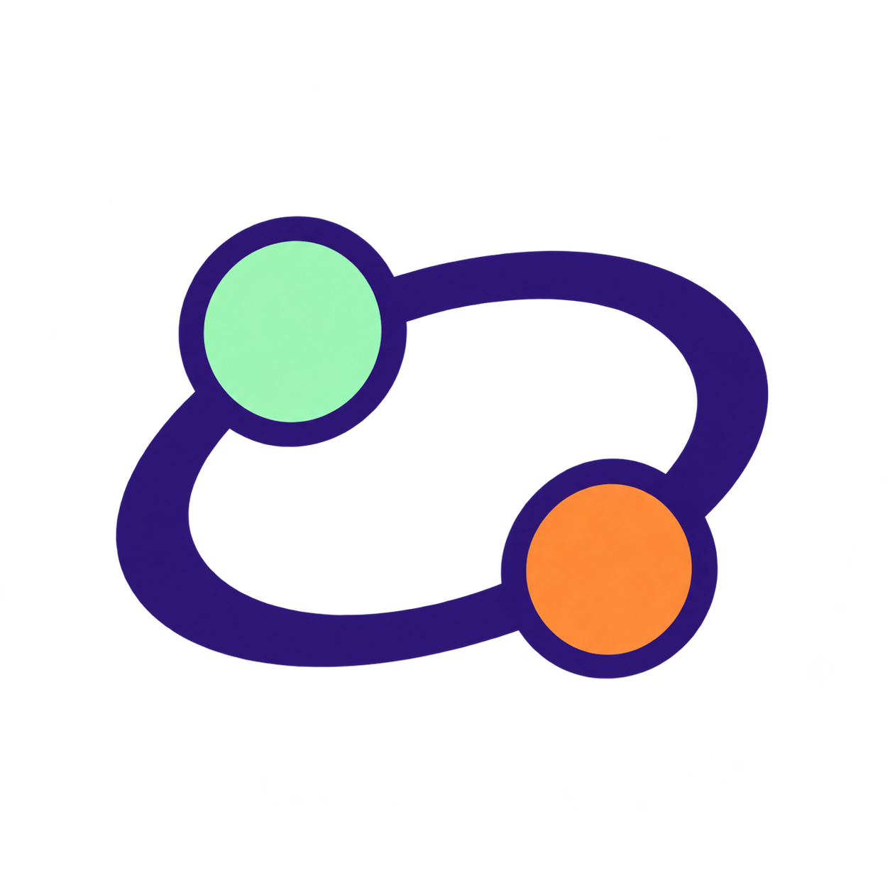

# Noriverse · 놀이버스

설치와 회원가입 없이 친구를 초대하고, 같은 방에서 여러 게임을 즐기는 브라우저 게임 플랫폼입니다.

## 로컬 개발 및 실행

Node.js 24를 사용합니다. 의존성을 설치한 뒤 웹 앱과 로컬 방 서비스를 별도 터미널에서 실행합니다.

```powershell
npm ci
npm run dev:rooms
# 새 터미널
npm run dev
```

[http://127.0.0.1:5173/](http://127.0.0.1:5173/)에서 게임을 골라 상세와 설정을 거쳐 시작할 수 있습니다. 오목은 한 기기 또는 온라인에서 친구와, 알까기는 한 기기에서 2인 대전 또는 혼자 연습할 수 있습니다. 친구 연결을 시험하려면 오목 설정에서 **친구와 온라인 → 방 만들기**를 선택합니다. 두 번째 창에서 초대 링크나 코드로 참가하면 호스트가 게임을 시작할 수 있습니다. 로컬 방 서비스는 Wrangler로 실행되며 계정 없이 SQLite Durable Object를 모의 실행합니다.

오른쪽 상단 톱니 버튼에서 언어, 테마, 배경음과 효과음 크기를 조절할 수 있습니다. 배경음과 효과음은 첫 상호작용 이후 브라우저에서 합성되며 설정은 브라우저에 저장됩니다.

첫 방문에 이름을 저장하면 익명 프로필을 만들 수 있습니다. 오른쪽 상단 프로필에서 전적과 공유 링크를 확인합니다. 프로필과 경기 기록은 로컬 Wrangler의 SQLite 저장소에, 편집 권한은 해당 브라우저의 쿠키에 있습니다.

규칙과 프로토콜 테스트는 `npm test`, 타입 확인과 번들은 `npm run build`로 실행합니다.

## 프로젝트 문서

- [서비스 기획과 벤치마킹](docs/product.md)
- [기술 설계와 인프라 검토](docs/technical-design.md)
- [로드맵과 Phase 1 검증 기준](docs/roadmap.md)
