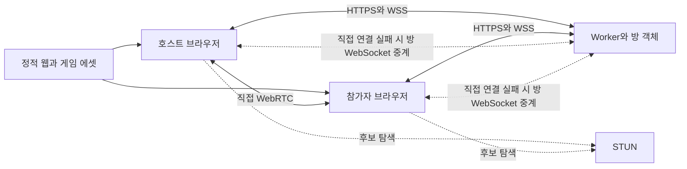

# Phase 0 기술 검토

현재 구현은 React·Vite, Phaser 4.2.1, Cloudflare Worker와 SQLite Durable Objects를 사용한다. 직접 WebRTC를 우선하고 연결이 어려운 참가자의 게임 메시지는 방 WebSocket이 중계한다. 관리형 TURN은 Phase 1의 비교 검증 후보다. 실기기 검증 결과와 출시 조건은 [로드맵](roadmap.md#phase-1-검증-범위와-기준)에서 관리한다.

## 환경과 타당성

로컬 개발 환경과 배포 절차는 [README](../README.md)에서 관리한다.

친구끼리 함께 접속하는 소규모 2D 게임은 호스트 브라우저가 상태를 관리하기에 적합하다. 턴제 게임으로 초대와 상태 동기화를 검증하고, 발사 후 결과가 정해지는 물리 게임으로 터치, 연속 상태, 프레임 비용을 추가 검증한다. 앱 전환에 따른 호스트 장기 정지와 악성 호스트를 허용하기 어려운 게임은 별도 설계가 필요하다.

| 위험 | 초기 대응과 재검토 기준 |
| --- | --- |
| 기업망·통신사 NAT에서 직접 연결 실패 | 처음부터 관리형 TURN을 검증한다. 직접·중계 비율, 성공률과 연결 시간을 측정한다. TURN/TLS 443까지 막히는 환경의 빈도가 높으면 중계 대안과 지원 범위를 다시 결정한다. |
| 모바일 호스트 정지·종료 | 상대 측에서 연결 중단을 감지해 일시 중단 UI를 띄운다. 복귀 시 상태를 재요청하고 유예 종료 시 경기 중단을 명시한다. 재발이 많으면 호스트 정책이나 경량 권위 서버 후보를 재검토한다. |
| 호스트 조작·정보 비대칭 | 호스트는 수신 입력을 검증하면서 전체 상태와 권한을 가진다. 비공개 역할과 제시어는 해당 참가자에게만 보낸다. 호스트에게도 숨겨야 하는 게임은 권한 모델을 다시 설계한다. |
| 기기별 렌더링, 터치, 로딩 | 실기기에서 초기 로딩, 프레임, 메모리, 회전 전후 입력 정확도를 측정한다. 엔진은 게임 진입 시 지연 로딩하고 게임 선택 이전에는 카탈로그만 내려준다. |
| 방 코드 추측, 신호 요청과 중계 남용 | 코드 만료·요청 제한, 세션에 묶인 신호 라우팅, 참가 검증 뒤 단기 TURN 자격증명 발급을 적용한다. 사용량 급증과 한도 도달을 기록한다. |
| 1인 개발에서 과도한 공통화 | 서로 다른 두 게임을 같은 로비와 뷰에서 실행해 실제 중복과 경계를 확인한다. 팀·타이머·라운드·숨겨진 정보 같은 기능은 요구 사례가 생길 때 해당 모듈을 확장한다. |

## 게임 엔진 비교

| 후보 | 제공 기능과 React 연결 | Noriverse 적합성 |
| --- | --- | --- |
| Phaser 4.2.1 / 3.90, MIT | 웹 2D 게임 프레임워크. WebGL·Canvas 렌더러, 씬, 스케일, 입력, 로더, 오디오, 애니메이션, Arcade·Matter 물리를 제공한다. [4.x 릴리스](https://phaser.io/download/phaser4) · [3.90 릴리스](https://phaser.io/news/2025/05/phaser-v390-released) · [Matter](https://docs.phaser.io/phaser/concepts/physics/matter) · [공식 저장소](https://github.com/phaserjs/phaser) | **현재 4.2.1 사용.** 고급 효과는 WebGL에서만 지원될 수 있으므로 두 렌더러를 확인한다. 4.x에서 렌더러가 재작성돼 iPhone·Android의 백그라운드 복귀, 컨텍스트 복원과 반복 전환을 검증한다. 모바일 회귀가 확인되면 같은 보드로 3.90을 비교한다. React TS 템플릿은 Phaser 3 예제이므로 4.x 패키지의 생명주기와 API를 직접 검증한다. [Phaser 4 렌더러](https://phaser.io/news/2026/04/phaser-4-renderer-faster-cleaner-and-built-for-modern-games) · [React TS 템플릿](https://github.com/phaserjs/template-react-ts) |
| Excalibur.js, BSD-2-Clause | TS 중심 웹 2D 게임 엔진. 씬·엔티티, 입력, 로더, 사운드, 애니메이션과 충돌·물리를 자체 제공한다. React에서 수명 관리를 연결한다. [공식 문서](https://excaliburjs.com/docs/) · [공식 저장소](https://github.com/excaliburjs/Excalibur) | Phaser가 실기기 기준을 충족하지 못하거나 해당 엔진의 간결한 TS 모델이 검증 비용을 크게 줄일 때 비교한다. 게임 예제 범위와 모바일 장애 대응 자료도 본다. |
| PixiJS 8, MIT | 2D 렌더링 라이브러리. WebGL·WebGPU, 디스플레이 트리, 자산 및 입력 이벤트를 제공한다. 공식 문서에서 Canvas 폴백은 실험적이다. [렌더링 문서](https://pixijs.com/8.x/guides/components/renderers) · [공식 저장소](https://github.com/pixijs/pixijs) | 보드나 그림 렌더링만 필요할 때 유력하다. 게임 생명주기, 오디오와 물리 등을 별도 구성해야 하므로 초기 플랫폼에서는 통합 작업이 늘어난다. |
| PlayCanvas, MIT | 웹 중심 3D 엔진. WebGL2·WebGPU, 입력·오디오와 에셋 파이프라인, Ammo 기반 물리와 React 통합 옵션을 제공한다. [엔진](https://github.com/playcanvas/engine) · [물리](https://developer.playcanvas.com/user-manual/physics/) · [React 물리 API](https://developer.playcanvas.com/user-manual/react/api/rigidbody/) | 3D가 주요 요구사항이 되면 재검토한다. 가벼운 2D 게임에서 3D 씬과 물리 경로를 쓰면 로딩 및 개발 복잡도가 늘어난다. |
| Godot 4, MIT | 자체 에디터와 2D·3D 도구를 갖춘 엔진. 웹 내보내기는 WASM과 WebGL 2가 필요하고, 스레드 사용 시 교차 출처 격리를 요구한다. React와 별도 런타임 간 통합이 필요하다. [웹 내보내기](https://docs.godotengine.org/en/stable/tutorials/export/exporting_for_web.html) · [라이선스](https://godotengine.org/license/) | 독립형 게임 에디터와 멀티플랫폼 배포에는 유리하다. 브라우저에서 잦은 게임 전환, React UI와의 상태 전달, 경량 배포에는 추가 비용이 있다. |

엔진 비교는 보드와 작은 원형 충돌 장면을 같은 해상도·리소스로 측정한다. 압축 전송 바이트, 캐시 없는 게임 진입 시간, 게임 전환 후 메모리, 저사양 모바일 프레임 시간, 회전·최대화·터치 안정성을 기준으로 본다. 라이선스는 엔진과 함께 배포되는 자산·폰트·서드파티 고지도 별도로 확인한다.

Phaser 공식 저장소에서 13년 이상의 개발 이력과 공개 릴리스를 확인했다. 3D는 별도 제품인 Phaser AE가 지원한다. [공식 저장소](https://github.com/phaserjs/phaser) · [Phaser 4 및 AE](https://phaser.io/news/2026/07/no-you-didn-t-miss-a-3d-update)

실제 3D 게임 요구가 생기면 PlayCanvas와 Babylon.js를 브라우저용 엔진 후보로 비교한다. PlayCanvas는 WebGL2·WebGPU와 에디터 기반 제작 흐름이 필요한 경우에, Babylon.js는 TypeScript 코드 중심으로 3D 씬과 물리 통합이 필요한 경우에 검토한다. 3D 보드 연출처럼 렌더링이 주 용도라면 Three.js도 후보다. 게임 등록과 로비는 엔진 타입과 무관한 실행 모듈을 로딩한다. 게임별 모듈이 Phaser나 3D 엔진을 선택하고, 로비·프로토콜·설정과 게임 진입 시 지연 로딩을 공유한다. 엔진별 생명주기의 공통 인터페이스는 실제 두 번째 엔진을 연결할 때 검증한다. [PlayCanvas](https://playcanvas.com/products/engine) · [Babylon.js](https://www.babylonjs.com/) · [Babylon.js 물리](https://doc.babylonjs.com/features/featuresDeepDive/physics) · [Three.js 렌더링](https://threejs.org/manual/pages/webgpurenderer)

## 플랫폼 스택과 대안

| 계층 | 제안과 선택 근거 |
| --- | --- |
| 플랫폼 | React + TypeScript + Vite 기반 정적 SPA. 초기 콘텐츠와 초대 경로는 정적 호스팅과 라우팅으로 처리한다. 검색 유입이 필요해지면 게임 소개 경로의 사전 렌더링을 검토한다. [Vite](https://vite.dev/guide/) |
| 설정과 상태 | CSS 커스텀 속성, `prefers-color-scheme`, `localStorage`, i18next + react-i18next. 로비와 경기 흐름은 명시적 상태 전이와 React reducer를 우선한다. [react-i18next](https://react.i18next.com/) |
| 게임 및 연결 | Phaser 우선, 브라우저 네이티브 WebRTC DataChannel, WSS signaling. 먼저 작은 범위의 연결/복구 로직을 검증하고, 래퍼가 실제 복잡도를 줄일 때 비교한다. [DataChannel](https://developer.mozilla.org/en-US/docs/Web/API/WebRTC_API/Using_data_channels) |
| 방 인프라 | 운영 웹은 GitHub Pages에 두고 API와 방 연결에는 Worker와 SQLite Durable Object를 사용한다. Workers Static Assets는 정적 호스팅 대안이다. 방 인프라 대안은 Node.js + Fastify의 소규모 인스턴스와 별도 관리형 TURN이다. 단일 인스턴스는 시작하기 단순하지만 재시작 복구, 배포, 지표 및 확장 책임이 더 크다. [Durable Objects](https://developers.cloudflare.com/durable-objects/) · [Fastify](https://fastify.dev/docs/latest/) |
| 개발 및 검증 | Node.js 24와 npm을 사용한다. 규칙·메시지·상태 전이는 Node 테스트 러너로 확인한다. 브라우저 간 흐름 검증에는 Playwright를 사용할 수 있으며 모바일 제약은 실기기에서 검증한다. [Playwright](https://playwright.dev/docs/emulation) |

## 시스템과 방의 수명



- **방 생성과 참가.** 서버는 8자 방 코드를 발급하고 정규화한 코드를 Durable Object에 매핑한다. 사용 중인 코드 예약을 방 객체에서 원자적으로 처리하고 충돌하면 다시 생성한다. 참가자는 별도 자리와 재접속 토큰을 받는다. 방장이 입장하지 않은 예약은 30분 뒤 만료된다. 게임을 바꾸거나 재경기해도 방과 참가자는 유지된다.
- **신호 교환.** HTTPS는 방 생성·참가에, WSS는 SDP와 ICE 후보 전달 및 접속 조정에 쓴다. Durable Object는 자리와 만료, 호스트 권한과 현재 소켓을 관리한다. WebSocket attachment로 소켓 정보를 관리하며 30초 간격의 연결 유지 신호에는 Durable Object가 자동 응답한다. [방 객체](../apps/signaling/room.ts) · [WebSocket Hibernation](https://developers.cloudflare.com/durable-objects/best-practices/websockets/)
- **호스트 중심 연결.** 참가자마다 호스트와 DataChannel 하나를 연다. 호스트 업로드는 수신자 수에 따라 늘어난다. 서비스에서는 STUN으로 직접 경로를 찾고, 7초 안에 준비되지 않은 참가자는 방 WebSocket 중계를 시도한다. 경로 유형은 대기실과 경기 정보의 참가자 아이콘에 표시한다. 중계 중 복사할 수 있는 진단은 최근 협상 단계, 후보 유형, 오류 코드를 담으며 SDP, 토큰, 원시 IP는 담지 않는다. [연결 구현](../apps/web/src/network/room-connection.ts)
- **전송 검증.** 접속 토큰과 방·플레이어·신호 대상을 연결하고 입력의 버전, 형태, 크기, 빈도와 권한을 확인한다. 외부 메시지는 런타임 스키마로 검사한다. 서버가 전달을 허용하는 신호 유형을 제한하고, 클라이언트에서 처리하는 게임 입력은 턴·좌표·중복을 검증한다. 로그는 오류 코드와 집계값 위주로 보관한다.
- **상태 동기화.** 턴제 경기는 순서를 보장하는 채널에서 입력과 경기 ID, 상태 리비전을 확인한다. 호스트가 상태를 확정하며 재연결 시 최신 스냅샷을 보낸다. 실시간 게임도 호스트가 결과를 확정한다. 알까기의 경우 각 브라우저가 발사 정보를 받아 물리를 로컬에서 계산하고, 호스트가 확정한 배치와 턴을 공유한다. [DataChannel 버퍼링과 메시지 크기](https://developer.mozilla.org/en-US/docs/Web/API/WebRTC_API/Using_data_channels)
- **단절과 복귀.** 같은 탭에서 새로고침하면 임시 토큰으로 같은 자리에 자동 복귀한다. 호스트 소켓이 사라지면 Worker가 방과 참가자 자리를 30초간 보존한다. 호스트 탭은 페이지를 떠날 때 현재 경기, 참가자와 경기 기록을 탭 전용 저장소에 보관한다. 돌아온 호스트는 경기 시계를 일시 정지 상태에서 복원하고 참가자들에게 스냅샷을 보낸다. 참가자 탭은 호스트에게 최신 스냅샷을 받는다. 호스트가 직접 방 나가기를 누르거나 복귀 유예가 만료되면 방을 종료한다. 모바일 운영체제가 페이지 저장 이벤트 전에 브라우저를 강제 종료하는 경우에는 호스트 경기 상태가 남지 않을 수 있다.

직접 연결이 성립하면 경기 데이터는 브라우저 사이를 오간다. 경기 중 직접 연결 단절을 감지하면 호스트가 경기와 타이머를 정지하고, 연결이 끊긴 경기 참가자의 자리 목록을 연결된 참가자에게 보낸다. 대기 팝업은 해당 이름과 P2P 복구 대기 시간을 표시한다. 호스트는 기존 연결이 복구되지 않으면 새 WebRTC 협상을 요청하고, 각 참가자의 직접 경로가 단절 감지 후 30초 안에 복구되지 않으면 기존 방 WebSocket 중계를 시도한다. 경기 참가자 전원이 다시 연결되면 호스트의 스냅샷을 적용하고 남은 시간을 이어간다. 대기 팝업에서 30초가 지나면 사용자가 방을 나갈 수 있다. 중계의 메시지 크기와 빈도를 제한하고 터치 좌표를 생략한다. 직접 경로와 중계 경로의 성공률, 지연 및 사용량을 구분해 검증한다. [WebRTC 연결](https://developer.mozilla.org/en-US/docs/Web/API/WebRTC_API/Connectivity) · [Durable Object WebSocket](https://developers.cloudflare.com/durable-objects/best-practices/websockets/)

중계가 열린 동안에는 호스트 브라우저가 참가자별로 10초 간격으로 별도의 WebRTC 연결을 협상한다. 새 DataChannel에서 왕복 통신이 확인되면 양쪽이 순서가 보장되는 기존 WebSocket에 전환 표시를 보내고, 먼저 도착한 직접 메시지나 전환 중 발생한 입력을 잠시 보관한다. 이전 메시지를 모두 받은 뒤 직접 경로를 사용한다. 협상 실패는 진행 중인 게임과 중계에 영향을 주지 않는다.

같은 네트워크에서 직접 연결이 반복 실패하면 `node tools/p2p-check/server.mjs`로 독립 테스트를 실행한다. PC와 모바일에서 콘솔에 표시된 LAN 주소를 열고 PC에서 시작한 테스트의 초대 주소로 모바일을 연결한다. SDP는 PC의 로컬 HTTP 서버로 교환하고 두 브라우저가 DataChannel로 메시지를 왕복한다. **LAN 주소 비교**를 선택하면 테스트 서버에 연결한 각 기기의 사설 IPv4 주소를 해당 기기의 mDNS 후보에 적용해 이름 해석 단계를 비교한다. **같은 네트워크 + STUN**에서는 서비스와 같은 STUN 서버를 사용한다. 결과에는 ICE 후보 유형과 경로별 요청·응답 횟수만 표시한다. 서비스의 트리클 ICE는 후보의 세대 식별자와 수집 완료 신호도 전달한다. [Trickle ICE 명세](https://www.rfc-editor.org/rfc/rfc8838.html#section-13)

PC·모바일 독립 테스트에서 STUN과 후보가 포함된 SDP로 직접 연결에 성공한 경로를 게임에도 사용한다. offer와 answer를 보내기 전에 후보 수집을 최대 1.2초 기다려 당시 후보를 SDP에 포함한다. 뒤늦게 들어온 후보는 각각 전달한다. 정상 진입과 중계 후 복귀에 같은 절차를 쓰며, 피어별로 협상 순서를 관리해 다른 참가자의 통신이 협상 완료를 기다리지 않게 한다. 로컬 개발에서 같은 STUN 경로를 검증하려면 `VITE_WEBRTC_STUN=true`를 사용한다.

외부 회선의 독립 경로는 두 기기에서 테스트 페이지를 미리 열고, 한쪽을 LTE·5G 또는 다른 회선으로 전환한 뒤 **서로 다른 인터넷 회선에서 테스트**에서 연결 신호를 직접 교환해 확인한다. 이 모드에는 LAN 서버 연결이 필요 없다. 공개 서비스에서도 같은 기기 조합으로 초대부터 첫 착수까지 확인하며, 직접 연결과 방 중계 성공을 구분한다. 연결 진단에는 선택된 ICE 후보 유형과 프로토콜 또는 실패 시 요청·응답 횟수를 표시한다. [WebRTC 통계 명세](https://www.w3.org/TR/webrtc-stats/)

방 보안을 보강할 때는 코드 재사용을 구분하는 내부 방 ID, 만료되는 초대 토큰, 방 잠금과 방장의 참가자 내보내기를 검토한다. 관리형 TURN을 검증할 경우 참가 권한을 확인한 뒤 단기 자격증명을 발급하고 UDP·TCP·TLS 경로를 비교한다. 연속 상태 전송이 필요한 게임이 생기면 덮어쓸 수 있는 위치 스냅샷에 별도 비순서 채널을 검토한다. [TURN 자격증명](https://developers.cloudflare.com/realtime/turn/generate-credentials/)

## 익명 프로필 저장

동일 출처에서 편집 권한을 담은 세션은 HttpOnly 쿠키에 둔다. Pages와 Worker의 출처가 다르면 Pages의 퍼스트파티 쿠키에 익명 세션을 저장하고 필요한 Worker 요청에 전달한다. Worker는 지정된 Pages 출처를 허용한다. 프로필과 경기 기록은 SQLite Durable Object에 저장하며, 로컬 Wrangler의 데이터와 공개 Worker의 데이터는 별개다. 종료 결과는 프로필별 경기 ID를 기준으로 중복 저장을 막는다. [웹 API 요청](../apps/web/src/network/api.ts) · [프로필 저장소](../apps/signaling/profiles.ts)

## 공통 프레임워크와 React 통합

| 영역 | 책임과 연결 방식 |
| --- | --- |
| 게임 등록 | 게임 ID, 번역 키, 모드·인원, 환경설정 스키마, 화면 방향과 최대화면 지원, 실행 모듈 로더를 등록한다. 라이브러리는 가벼운 메타데이터만 읽는다. 조립 지점이 게임들을 연결하고 플랫폼과 공통 런타임은 개별 게임을 참조하지 않는다. |
| 게임 규칙과 세션 | 게임별 순수 규칙은 입력 검증, 상태 전이와 결과를 제공한다. 로컬과 네트워크 경기는 공통 경기 생명주기를 거친다. 방 ID와 경기 ID를 구분하고 재경기와 게임 전환 시 새 경기 ID를 생성한다. 실시간 게임의 호스트 전용 물리는 렌더러와 분리된 실행 책임으로 다룬다. |
| 렌더링 통합 | React의 고정된 마운트 요소에서 게임 진입 시 엔진과 Scene을 초기화한다. 정리 시 엔진, 구독과 로딩을 해제한다. 비동기 로딩은 이미 해제된 마운트에 설치되지 않게 하고 Strict Mode 이중 setup/cleanup을 검증한다. React는 프레임당 상태를 렌더하지 않고, 이벤트를 통해 로비·결과·메뉴에 필요한 상태만 구독한다. Phaser 스케일·입력·오디오·리소스 기능을 직접 활용한다. [React useEffect](https://react.dev/reference/react/useEffect) · [Phaser Scale Manager](https://docs.phaser.io/api-documentation/class/scale-scalemanager) |
| UI 흐름 | 공통 상태 전이와 접근 가능한 화면 셸에 카탈로그 → 상세·모드 → 방 생성 또는 초대 참가 → 로비 → 경기 → 결과 → 재경기·로비 복귀를 둔다. 초대 URL은 카탈로그를 거치지 않고 해당 방 참가 화면으로 보낸다. 방 만료·정원 초과·재연결을 같은 화면 체계에서 표시한다. 준비 상태, 카운트다운, 팀과 라운드는 필요한 게임에서만 활성화한다. 게임은 규칙 안내, 설정 UI, 결과 상세를 제공한다. |
| 설정과 표시 | 페이지는 시스템·라이트·다크 중 선택값을 저장하고 시스템 모드에서 미디어 쿼리 변경을 반영한다. 테마는 토큰과 CSS 변수로 공유하고 Canvas에는 테마 변경 이벤트를 전달한다. 한국어·영어를 공통 i18next 인스턴스와 게임별 지연 로딩 네임스페이스로 제공한다. 저장소 접근 실패의 기본값, 누락 키 폴백, HTML lang, 게임 웹폰트 및 숫자 형식을 검증한다. 네트워크는 메시지 코드와 값만 보내며 참가자가 자기 언어로 번역한다. 테마·언어 변경 이벤트는 Scene 및 경기 인스턴스를 유지하면서 표시만 갱신한다. |

타이머, 팀, 라운드와 접근성 UI는 플랫폼이 제공하는 옵션이다. 첫 두 게임에서 실제로 필요한 부분부터 구현하며 엔진 클래스 전체를 별도 API로 감싸지 않는다. 게임 보드의 입력과 결과는 Canvas에서 처리할 수 있고, 키보드 조작 및 접근 가능한 규칙·현재 턴·결과 안내는 공통 React UI와 연결한다.

## 모바일, 최대화면과 화면 방향

일반 화면에서 세로·가로 배치를 먼저 제공한다. 권장 방향은 게임 메타데이터로 제시하고 지원 여부와 안내는 공통 셸이 처리한다. 사용자가 최대화 버튼을 누를 때 게임과 메뉴를 함께 담는 컨테이너에 Fullscreen API를 요청한다. 불가하거나 거부되면 동일 컨테이너를 페이지 안에서 뷰포트에 고정하는 확장 모드로 전환한다. 브라우저 UI 숨김과 방향 잠금은 지원 여부에 따르며 방향 잠금이 거부되면 회전 안내를 표시한다. 복귀 버튼, 브라우저의 해제 이벤트, 원래 스크롤과 포커스 복구를 처리한다. [Fullscreen API](https://developer.mozilla.org/en-US/docs/Web/API/Element/requestFullscreen) · [방향 잠금](https://developer.mozilla.org/en-US/docs/Web/API/ScreenOrientation/lock)

`dvh`, safe-area inset, 레이아웃 크기 관찰을 공통 셸이 처리한다. 자동 해상도는 고정 내비게이션 아래에서 경기 카드 내부의 툴바·하단 조작 영역·여백과 캔버스를 맞추고, 준비가 끝나면 카드를 표시 영역 중앙으로 스크롤한다. 게임 화면의 비율을 유지하며 렌더링 버퍼에는 표시 크기와 기기 픽셀 밀도를 반영한다. 가로 상한은 자동 1920px 또는 수동 선택값이며, 설정에 실제 버퍼 해상도와 필요한 경우 CSS 표시 크기를 함께 표시한다. 회전, 주소창과 키보드 변화, 해상도 조절에도 게임 좌표와 진행 상태를 유지한다. [화면 크기 계산](../apps/web/src/games/render-resolution.ts) · [동적 뷰포트 단위](https://developer.mozilla.org/en-US/docs/Web/CSS/Reference/Values/length) · [CSS safe area](https://developer.mozilla.org/en-US/docs/Web/CSS/Reference/Values/env)

## 저장소 구조

```text
apps/
  web/                  React UI, 카탈로그, 로비, 설정, 게임 조립
  signaling/            방과 연결 신호, WebSocket 중계, 프로필·친구 저장
packages/
  protocol/             버전, 메시지 타입과 런타임 검증
docs/                   기획, 주요 설계 근거 및 로드맵
```

`apps/web/src`에는 `platform`, `network`, `games/<id>`와 공용 자산을 둔다. 웹 앱과 신호 서비스가 같이 쓰는 프로토콜을 공유 패키지로 관리한다. 다른 공통 코드는 별도 실행 환경에서도 실제로 재사용할 때 패키지 분리를 검토한다.

## 인프라와 운영 비용

가격은 2026년 11월 20일 확인 기준 USD이며, 아래 계산은 사용량 가정이다. 필요한 인프라는 HTTPS 정적 배포, 방별 신호·임시 저장소, STUN/TURN, 서비스 지표와 배포 환경이다. 상용 도메인, 세금, 필요 시 외부 모니터링 비용은 별도다.

| 항목 | 후보 요금과 운영 포인트 |
| --- | --- |
| 정적 웹·게임 에셋 | Workers Static Assets 자체 요청은 무료이며 Worker를 호출한 동적 요청은 별도 과금된다. 초대 경로의 SPA fallback과 API를 분리해 정적 트래픽이 불필요하게 Worker를 실행하지 않도록 한다. [정적 자산 과금](https://developers.cloudflare.com/workers/static-assets/billing-and-limitations/) |
| Worker + Durable Objects | 무료 한도 내 월 $0. Paid 기본 월 $5, Worker와 객체의 사용량 한도는 따로 적용된다. Free 객체는 일 100,000 요청·13,000 GB-s의 계산 한도와 별도 저장 한도를 가진다. Paid 객체는 월 100만 요청 및 400,000 GB-s 포함 후 각각 100만당 $0.15와 $12.50. Hibernation을 사용하고 저장·만료 알람·요청 수를 계측한다. 무료 한도 소진 시 관련 동작이 실패한다. [Workers 요금](https://developers.cloudflare.com/workers/platform/pricing/) · [Durable Objects 요금](https://developers.cloudflare.com/durable-objects/platform/pricing/) |
| STUN/TURN | Cloudflare STUN 무료. Realtime TURN과 SFU가 공유하는 월 1,000 GB 무료량을 적용한 뒤 중계 서버 발신량 GB당 $0.05. TURN 프로토콜 오버헤드와 복수 중계 경로를 포함해 공급자 지표로 집계한다. [TURN FAQ](https://developers.cloudflare.com/realtime/turn/faq/) · [Realtime 요금](https://developers.cloudflare.com/realtime/sfu/platform/pricing/) |

가령 월 10,000경기, 중계 이용 20%, 중계를 이용한 경기당 실제 청구 발신량 10 MB라면 약 20 GB로 TURN $0이다. 월 1,200 GB가 청구 대상이 되는 시나리오라면 무료량 공유에 다른 사용이 없을 때 TURN $10이며 Workers Paid 기본료까지 합쳐 $15부터다. 이는 도메인·세금·기타 초과료 제외 예시다. 중계 비율과 경기당 발신량은 고정값으로 간주하지 않는다. 활성 방 수, 연결 시도·성공률, P95 연결 시간, 중계 발신량, 오류율과 만료 저장량을 기록하고, 무료 한도와 예산이 가까워지면 알림을 둔다. 처리량 또는 지역 접속 요구가 커지면 관리형 대안과 자체 TURN의 비용, 관리·보안 업데이트 부담을 함께 비교한다.
